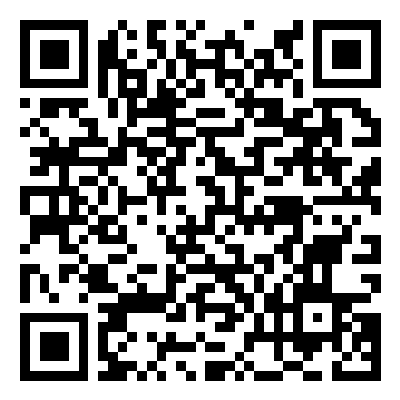

# wayne-anti · 白名单机制 · Claude/KYC 安全分流规则

> **白名单机制（默认走代理）**：兜底 `FINAL,proxy`，只用规则把「国内网站」挑出来**走直连**，未收录 / 难判定的流量**默认走代理**（fail-safe，安全）。
> 与之相对的「黑名单机制」是默认直连、只把被墙站挑出来走代理（fail-open，漏一个域名就暴露真实 IP）。

基于 [Johnshall/Shadowrocket-ADBlock-Rules-Forever](https://github.com/Johnshall/Shadowrocket-ADBlock-Rules-Forever) 的 `sr_cnip_ad.conf`（国内外划分 + 广告过滤）优化，加入 **Claude / Anthropic / Persona(KYC) 全域名强制代理**。

## 一键导入（可直接扫码）

| GitHub Pages（推荐） | Gitea（备用） |
|:---:|:---:|
|  |  |
| <https://is-wayne.github.io/anti-awful-claude-rules/wayne-anti-whitelist.conf> | <https://git.iswayne.com/wayne/anti-awful-claude-rules/raw/branch/main/wayne-anti-whitelist.conf> |

**用法**：用 Safari 或 Shadowrocket 扫上面二维码；或 Shadowrocket →「配置」→ 右上角 **+** → 粘贴 URL → 下载 → 断开重连一次生效。

> 落地页（同样是二维码，可视需要打开）：<https://is-wayne.github.io/anti-awful-claude-rules/>

## 机制说明：为什么是「白名单」

- `FINAL,proxy`：未收录 / 难判定的流量默认**走代理**（fail-safe，安全）。
- `FINAL,DIRECT`：未收录的流量默认**直连**（fail-open，漏）。

对账号 / 隐私敏感场景（Claude、KYC、支付），必须选**白名单机制（默认代理）**。真实翻车复盘：Mac 端用 `FINAL,DIRECT` 白名单式，KYC 上传证件的 `withpersona.com` 未被收录 → 直连暴露真实国内 IP；手机端 `FINAL,proxy` → 走代理；双端 IP 不一致 → KYC 完成即封。

## 相对原规则的改动

1. `[Rule]` **顶部置顶** Claude / Anthropic / Persona-KYC 强制代理（first-match-wins，优先于广告 `Reject` 与 `GEOIP,CN`）。
2. 补回原 ip.net.coffee「可复制清单」遗漏的 KYC 域名：`withpersona.com` / `frompersona.com` / `maps.googleapis.com`。
3. v2 增强：顶部加**局域网 / 私有地址直连**（`127/8`、`10/8`、`172.16/12`、`192.168/16`、`169.254/16`、`::1`、`fc00::/7`、`fe80::/10`，`no-resolve`）；加 `DOMAIN-KEYWORD,statsig`；Anthropic 自有网段兜底 `IP-CIDR,160.79.104.0/21`、`IP-CIDR6,2607:6bc0::/32`。

原有「国内外划分 + 广告过滤 + `FINAL,proxy`」全部保留。

## DNS / WebRTC / UDP 防泄漏（配合本规则）

- **DNS**：走代理的域名，其 DNS 查询在节点侧解析。只要**目标域名与 IP 都在规则里**（本规则已把 Claude/KYC 全部显式代理），就不会漏；怕漏就用本规则的**白名单兜底 `FINAL,proxy`**。
  - 验证：[dnsleaktest.com](https://www.dnsleaktest.com/) 只显示节点 DNS、无本地运营商才算过。
  - 参考教程：<https://youtu.be/gRpViKi23jQ?is=YXyQr71mzQsTHgiv>
- **WebRTC**：Shadowrocket 有内置「**禁用 STUN**」开关，直接开即可；桌面端 Firefox 可在 `about:config` 关 `media.peerconnection.enabled`，Chrome 装 *WebRTC Control* 扩展。
  - 验证：[browserleaks.com/webrtc](https://browserleaks.com/webrtc) 只暴露节点 IP、无本地 IP 才算过。
  - 参考教程：<https://youtu.be/ONd_rAYLji0?is=utzTbZvGeMZJp7pa>
- **STUN / UDP**：STUN 走 UDP 端口 `3478 / 5349 / 19302`。Shadowrocket 开「禁用 STUN」即可；若用 sing-box / clash 内核，把 STUN 协议与这些 UDP 端口路由到代理，参考：

```json
{ "action": "sniff", "sniffer": ["tls","http","quic","stun","dns"], "timeout": "300ms" },
{ "protocol": "stun", "outbound": "🚀 默认代理" },
{ "port": [3478, 5349, 19302], "network": "udp", "outbound": "🚀 默认代理" }
```

## 应用后验证

1. `https://withpersona.com/cdn-cgi/trace` → 应为节点地区（如 `SG`），不是 `CN`；
2. 手机与电脑都打开 `https://www.cloudflare.com/cdn-cgi/trace` → 两端 `ip=` 一致；
3. `dnsleaktest.com` / `browserleaks.com/webrtc` 只暴露节点、无本地运营商/本地 IP；
4. 全部通过再进行登录 / KYC。

## 文件

- `wayne-anti-whitelist.conf`：完整 Shadowrocket 配置（基于 `sr_cnip_ad.conf`，约 5.37 万行，白名单机制）。
- `claude-kyc-proxy.snippet`：仅 Claude / KYC 的置顶规则块，便于粘贴到现有配置。
- `index.html` / `qr/`：GitHub Pages 落地页与二维码。
- `push-both.sh`：一键提交并同时推送到 GitHub + Gitea。

## 维护（双推）

```bash
./push-both.sh "提交说明"
```

## 来源与许可

- 规则基底：[Johnshall/Shadowrocket-ADBlock-Rules-Forever](https://github.com/Johnshall/Shadowrocket-ADBlock-Rules-Forever)（`sr_cnip_ad.conf`）。
- Claude / Anthropic / KYC 域名清单：[ip.net.coffee](https://ip.net.coffee/claude/site.html)。
- 出口 IP 选型 / KYC 风控方法论参考：[NexIP 博客](https://nexip.net/blog/289.html)、NodeSeek 讨论帖。

本作品采用 **CC BY-SA 4.0** 许可（与原项目一致），详见 [LICENSE](LICENSE)。
